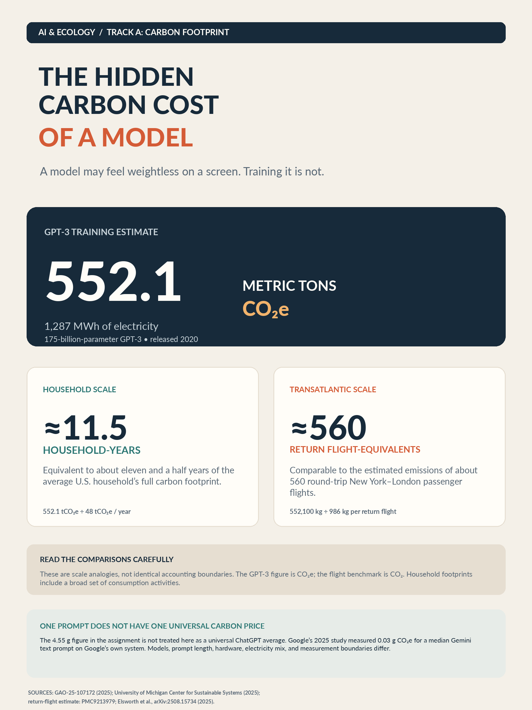

# Week 12 – AI & Ecology

**Track A — Carbon Footprint Visualization**  
**Core question:** Is AI sustainable? What ecological trade-offs are we willing to accept?

## The Artifact

### Key figure

- **GPT-3 training estimate:** 552.1 metric tons CO₂e.
- **Electricity:** 1,287 MWh.
- **Comparison:** approximately 11.5 average U.S. household-years.
- **Comparison:** approximately 560 round-trip New York–London passenger-flight equivalents.

The household and flight comparisons communicate scale, not identical accounting boundaries. The GPT-3 figure is CO₂e, the flight comparison is CO₂, and the household estimate covers a broad set of consumption activities. These are analogies, not exact equivalencies.

### Data transparency decision

The assignment's 4.55 g per ChatGPT query estimate is not treated as a universal value. A 2025 Google study reported 0.03 g CO₂e for a median Gemini text prompt on Google's own system; that number cannot be transferred to ChatGPT. Per-prompt impact varies with model, prompt length, hardware, location, electricity mix, and measurement boundary. The uncertainty is part of the argument: providers need to disclose comparable, service-specific information.

## Research Documentation

I built this project around carbon because it gives the hidden computation behind AI a measurable scale. The U.S. Government Accountability Office’s April 2025 assessment lists GPT-3, a 175-billion-parameter model released in 2020, at 1,287 megawatt-hours of training electricity and an estimated 552.1 metric tons of carbon-dioxide equivalent (CO₂e). This is a reported estimate, not an audited disclosure from the developer. The GAO warns that companies generally do not publish enough information about training energy and water, so independent estimates rely on incomplete data about hardware, workload, training time, and electricity sources.

I compared the figure with two benchmarks. The University of Michigan Center for Sustainable Systems estimates an average U.S. household footprint of 48 metric tons CO₂e per year; 552.1 divided by 48 is about 11.5 household-years. A published estimate places a passenger’s round-trip New York–London flight at about 986 kilograms of CO₂; 552,100 kilograms divided by 986 is about 560 flight-equivalents. These are scale comparisons, not identical accounting boundaries: the flight figure is CO₂, while the GPT-3 figure is CO₂e, and household footprints cover many activities.

The hardest data to find was a reliable carbon figure for one ordinary AI prompt. I did not treat the assignment’s 4.55-gram figure as a universal ChatGPT average. Per-prompt estimates vary with model, prompt length, hardware, data-center efficiency, location, electricity mix, and what is counted. Google’s 2025 production study reported 0.03 grams CO₂e for a median Gemini text prompt, but that measures Google’s system, not ChatGPT. The GAO also notes that provider disclosures and independent estimates remain limited.

This uncertainty is part of the finding: without standardized, model-level reporting, users cannot make fair comparisons. The visualization therefore emphasizes a documented training estimate, labels its comparisons, and treats transparency as a sustainability requirement.

## Artist Statement

I chose carbon because it makes AI’s hidden infrastructure easier to see. A prompt feels weightless: I type a sentence, receive an answer, and move on. But the computation depends on servers, electricity, cooling, and hardware. The GPT-3 training estimate—552.1 metric tons of CO₂e—turns that invisible process into a scale I can compare with household emissions and air travel. The comparisons are labeled as approximations because the sources do not measure exactly the same things.

The cost that concerns me most is not only the carbon attached to a model or prompt. It is the growth of infrastructure while the public has limited access to reliable information about its energy, water, and material footprint. A low estimate can encourage use; a high estimate can mislead when its assumptions are hidden. Both efficiency and total demand matter.

Can AI become sustainable? It could become less harmful, but this requires more than asking users to send fewer prompts. Companies need to publish comparable lifecycle data, use additional low-carbon electricity, reduce water stress near facilities, and design hardware for longer use, repair, and recovery. Governments and local communities need a role in deciding where infrastructure is built and who bears its costs.

My responsibility is to use AI: avoid requests, choose simpler tools when they are enough, and question claims that present digital services as impact-free. Individual restraint cannot replace corporate disclosure or public policy. The question is who decides, who benefits, and who is left with the environmental bill.
