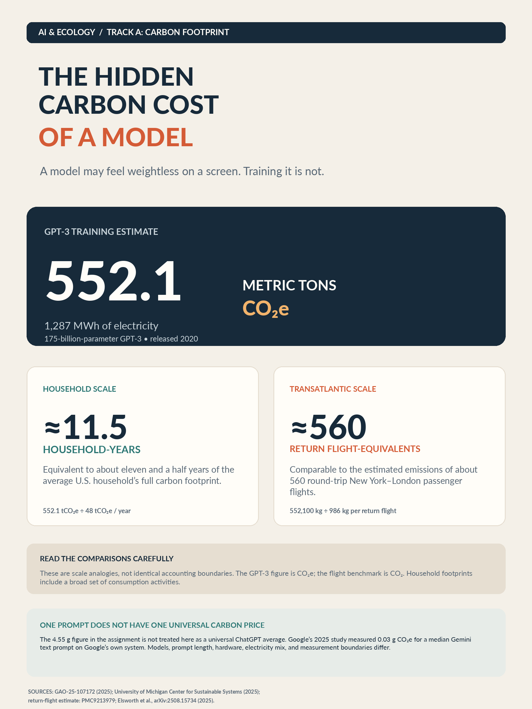

# Sustainability & Ethics

## Page navigation

- [My Research](#my-research)
- [Data Sources](#data-sources)
- [Personal Reflection](#personal-reflection)
- [Systemic vs. Individual](#systemic-vs-individual)

## The hidden carbon cost of a model

### GPT-3 training estimate

# 552.1 metric tons CO₂e

**1,287 MWh of electricity** · 175-billion-parameter model · released in 2020.

### Making the number understandable

| Comparison | Approximate equivalent | Calculation |
|---|---:|---|
| Average U.S. household footprint | **11.5 household-years** | 552.1 metric tons CO₂e ÷ 48 metric tons CO₂e per household-year |
| Round-trip New York–London passenger flights | **560 flight-equivalents** | 552,100 kg ÷ 986 kg CO₂ per round-trip passenger flight |

These are scale comparisons, not identical accounting boundaries. The GPT-3 figure is CO₂e; the flight benchmark is CO₂. Household footprints cover a broad range of consumption activities. Treat the ratios as approximate analogies, not exact equivalencies.

### One prompt does not have one universal carbon price

The 4.55 g figure in the assignment is not presented here as a universal ChatGPT average. Google’s 2025 production study measured 0.03 g CO₂e for a median Gemini text prompt on Google’s own system. That figure cannot be transferred to ChatGPT: models, prompt length, hardware, electricity mixes, and measurement boundaries differ.

## My Research

The U.S. Government Accountability Office’s 2025 technology assessment lists GPT-3 training at 1,287 megawatt-hours and 552.1 metric tons of CO₂e. The number makes the material side of AI harder to ignore: behind a model are energy-hungry servers, cooling systems, and specialized hardware. It is an estimate assembled from literature and industry documentation, not a public, independently audited disclosure from the model developer.

For context, the University of Michigan’s Center for Sustainable Systems estimates an average U.S. household footprint of 48 metric tons CO₂e per year. On that basis, the GPT-3 training estimate is about 11.5 household-years. A separate published estimate of 986 kg CO₂ for a passenger’s round-trip New York–London flight gives roughly 560 flight-equivalents. These comparisons help make the scale visible, but they are not perfectly matched measures.

The carbon figure is only one part of the ecological cost. Data centers also require water for cooling, electricity generation has its own water footprint, and hardware manufacturing depends on mined materials. A 2025 *Nature Sustainability* study projected that U.S. AI-server deployment could add 24–44 million metric tons of annual CO₂e emissions and an annual water footprint of 731–1,125 million cubic meters over its 2024–2030 scenarios. Those are projections, not measured totals. The central question is therefore not whether AI has a footprint, but whether its benefits justify the resource use—and who gets to decide.

## Data Sources

1. **U.S. Government Accountability Office.** *Generative AI’s Environmental and Human Effects* (GAO-25-107172, April 2025), especially Table 1. Reports GPT-3 training at 1,287 MWh and 552.1 metric tons CO₂e; warns that developer disclosures and estimates are incomplete. [Read the GAO report](https://www.gao.gov/products/gao-25-107172).
2. **University of Michigan, Center for Sustainable Systems.** *Carbon Footprint: Sustainability Indicators* (2025). Reports an average U.S. household footprint of 48 metric tons CO₂e per year. [Read the factsheet](https://css.umich.edu/sites/default/files/2025-09/CSS09-05_0.pdf).
3. **Everyday environmental comparison.** A published medical sustainability study uses approximately 986 kg CO₂ per passenger for a round-trip London–New York flight. [Read the study](https://pmc.ncbi.nlm.nih.gov/articles/PMC9213979/). Flight estimates vary with aircraft, route, occupancy, and calculation method.
4. **Xiao, Tianqi, et al.** “Environmental impact and net-zero pathways for sustainable artificial intelligence servers in the USA.” *Nature Sustainability* 8 (2025): 1541–1553. Projects U.S. AI-server water and carbon footprints under different deployment scenarios. [Read the article](https://doi.org/10.1038/s41893-025-01681-y).
5. **Elsworth, Cooper, et al.** “Measuring the Environmental Impact of Delivering AI at Google Scale” (2025). Reports 0.24 Wh, 0.03 g CO₂e, and 0.26 mL water for a median Gemini Apps text prompt in May 2025, using Google’s full-stack measurement method. [Read the paper](https://arxiv.org/abs/2508.15734). This is company-specific and not a ChatGPT estimate.
6. **International Energy Agency.** *Energy and AI* (2025), plus its April 16, 2026 update on data-center electricity demand. The IEA reports that data-center electricity demand rose 17% in 2025 and AI-focused data centers grew faster. [Read the IEA analysis](https://www.iea.org/reports/energy-and-ai) · [Read the 2026 update](https://www.iea.org/news/data-centre-electricity-use-surged-in-2025-even-with-tightening-bottlenecks-driving-a-scramble-for-solutions).
7. **Crawford, Kate.** *Atlas of AI: Power, Politics, and the Planetary Costs of Artificial Intelligence*. Yale University Press, 2021. Conceptual framework for understanding AI as an extractive system built from minerals, energy, labor, and data. [Publisher information](https://yalebooks.yale.edu/book/9780300264630/atlas-of-ai/).

All figures are tied to their stated source, year, and measurement boundary. CO₂e is a common unit that expresses different greenhouse gases in terms of the warming impact of carbon dioxide.

## Personal Reflection

### My AI use habits

I mainly use ChatGPT as an academic and project-support tool. The available recent conversation record shows uses such as developing a GitHub project description, comparing resumes, analyzing cultural-extraction scenarios, and researching and developing this AI & Ecology assignment. My broader use also includes technical learning, research summaries, and writing support. I often work iteratively by asking follow-up questions and refining an answer rather than using only one prompt.

### Estimated impact

I reconstructed a partial seven-day record for November 14–20, 2026 from the conversation information available to me. It contains **at least five visible task requests**: two on November 14, one on November 15, and two on November 20. The available record does not provide a full account-wide prompt count. November 16–19 have no dated usage details surfaced, so I have marked them unknown rather than zero.

Using the assignment’s 4.55 g CO₂/query estimate only as an illustrative scenario, five visible task requests would correspond to **22.75 g CO₂** (5 × 4.55 g). This is not a measured weekly footprint: the task-request count is incomplete, a task may include multiple model calls, and 4.55 g is not a verified universal ChatGPT emissions factor. I have not added image, video, or audio emissions because the surfaced records do not establish user-requested generations of those types during this period.

### What I am willing to change

I can combine related questions, avoid repeated requests when an answer is already sufficient, use ordinary search or course materials for simple factual lookups, and reserve image or video generation for tasks where it adds real value. I can also check whether an answer meets the need before requesting another version.

### What I cannot or will not change—and why

I do not want to stop using AI as a learning aid when it helps me work through a difficult concept, examine competing arguments, or develop meaningful academic work. The goal should not be to make students feel personally guilty for every useful interaction. I want to use the tool more deliberately while expecting providers and institutions to measure and reduce the infrastructure costs they control.

## Systemic vs. Individual

### What individuals can do

Use AI with a purpose, reduce duplicate prompts and unnecessary regenerations, choose a lighter-weight tool when it can do the job, extend the life of devices, and ask providers for environmental information. These actions can reduce avoidable demand, but they do not determine where data centers are built or how their electricity is generated.

### What requires systemic change

Companies should report model-level energy, carbon, and water use across training and operation, disclose measurement boundaries, and account for hardware manufacturing and disposal. They should prioritize additional low-carbon power, water-aware siting and cooling, repairable equipment, and responsible materials recovery. Governments should set reporting standards, review grid and water impacts, and give affected communities a real role in siting decisions.

### Who is responsible?

Responsibility is shared, but it is not equal. AI developers and data-center operators have the greatest control over infrastructure and access to operational data. Policymakers and utilities shape incentives, standards, and grid choices. Universities and other institutional buyers can demand transparency. Individual users have a smaller but real role in reducing low-value demand and asking questions. Personal restraint cannot substitute for institutional accountability.

Kate Crawford’s account of AI as an extractive system is useful here: the “cloud” depends on physical resources and on decisions about whose land, water, labor, and energy are used. A sustainability claim should therefore ask not only how much carbon a system emits, but also where its materials come from, where its facilities operate, who benefits, and who carries the costs.